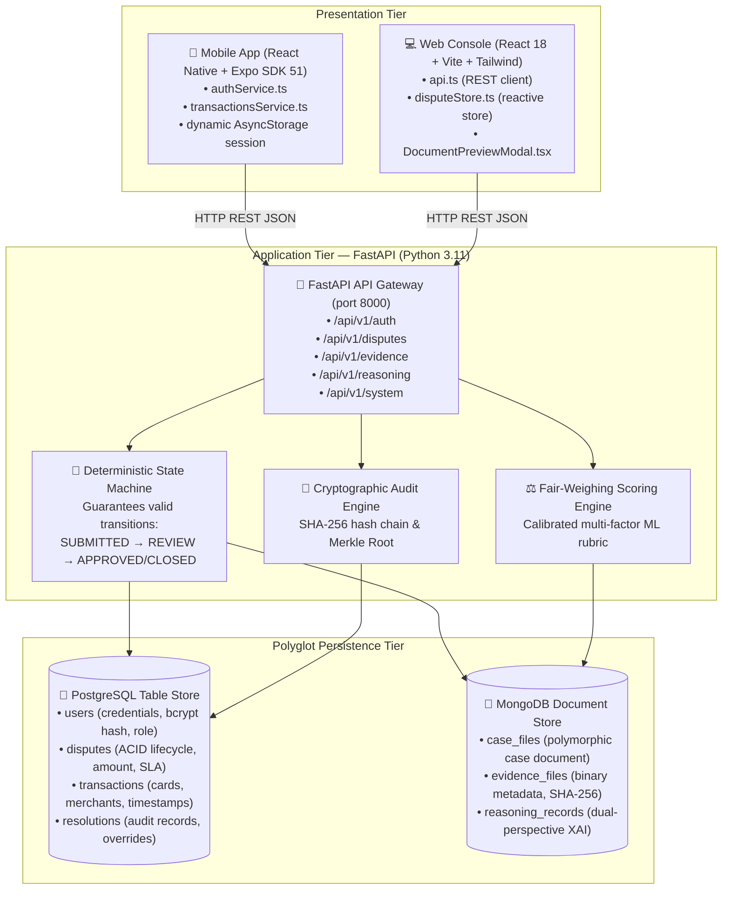

# ⚖️ VerdictAI: Final Working Application Documentation

**Course:** IT644 — Web Services & Service-Oriented Architecture (SOA)  
**Instructor:** Prof. JayPrakash Lalchandani  
**Project Lead & Backend/Database Architect:** Nirav Kachhiya (DAU Student ID: 202512011)  
**Repository:** [VerdictAI GitHub Repository](https://github.com/niravkachhiya/VerdictAI)  
**Live Cloud Deployment (Web Portal):** [https://verdictai-web.onrender.com](https://verdictai-web.onrender.com)  
**Live Cloud Deployment (REST API Gateway):** [https://verdictai-api-i4yd.onrender.com/docs](https://verdictai-api-i4yd.onrender.com/docs)  

---

## Executive Summary

**VerdictAI** is an enterprise-grade, service-oriented dispute and chargeback resolution platform designed to transform a $30+ Billion global banking industry bottleneck. Traditional credit card chargeback lifecycles require 14 to 45 business days across cardholders, merchants, card associations (RuPay, Visa, Mastercard), and acquiring/issuing banks. VerdictAI collapses this timeframe to under 5 minutes through automated polymorphic evidence ingestion, dual-perspective NLP discrepancy extraction, calibrated Fair-Weighing ML scoring, plain-language explainable AI (XAI), and cryptographic Merkle-ledger sealing.

This document summarizes the **three core submission criteria**:
1. **Complete Feature Set (Fully Functional App)** across Mobile (React Native + Expo), Web (React 18 + TypeScript), and Backend.
2. **Frontend + Backend + Database Integration** detailing end-to-end data flow, polyglot persistence (PostgreSQL + MongoDB), and state synchronization.
3. **API Integration (On Need Basis)** providing comprehensive REST specifications, request/response contracts, and state transition guarantees.

---

## 1. Complete Feature Set (Fully Functional App)

VerdictAI delivers four distinct, role-based user experiences operating on a unified service-oriented architecture:

```
+-----------------------------------------------------------------------------------+
|                               VerdictAI Platform                                  |
+-------------------+-------------------+-------------------+-----------------------+
|  👤 Cardholder    |  🏪 Merchant      |  🛡️ Dispute-Ops   |  ⚖️ Autonomous ML/XAI |
|  Consumer Portal  |  Rebuttal Portal  |  Bank Admin Core  |  Audit Ledger Engine  |
+-------------------+-------------------+-------------------+-----------------------+
```

### 1.1. Consumer Cardholder Portal (Mobile & Web)
*Available on Android/iOS via React Native (Expo) and Web via React 18.*
- **Zero-Trust Authentication & Session Isolation:** Real authentication via `POST /api/v1/auth/login` and `POST /api/v1/auth/register/cardholder` with SHA-256 hashed passwords and JWT token storage. Mismatched or invalid credentials are strictly rejected. Each user gets an isolated session bound to their unique cardholder ID (`usr_<id>`).
- **Claim Initiation & Wizard:** 3-step dispute filing flow capturing contested transaction ID, dispute category (`PRODUCT_NOT_RECEIVED`, `DUPLICATE_PROCESSING`, `FRAUD_UNRECOGNIZED_CHARGE`, `PRODUCT_DAMAGED_OR_DEFECTIVE`), disputed amount, factual cardholder statement, and optional photo/receipt evidence attachment.
- **Dynamic Dispute Tracker:** Live claims dashboard displaying Active In-Flight vs. Resolved claims, SLA countdown timers (48h merchant response window), real-time status chips (`Review Required`, `Auto-Resolved`, `Approved`, `Refuted`), and transaction amounts.
- **Plain-Language Explainability (XAI):** Cardholders view transparent, non-technical rationales generated by Google Gemini explaining why a dispute was approved or what evidence is required.
- **Card & Profile Security Management:** Interactive card wallet displaying masked cards (`HDFC RuPay Platinum **** 4492`, `ICICI Coral Visa **** 8102`), primary card toggle, +Add Card modal, biometric authentication toggle (Face ID / Touch ID), and cryptographic Merkle ledger fingerprint verification.

### 1.2. Merchant Chargeback Rebuttal Portal (Web)
*Engineered for Store Operations Managers and Enterprise Merchant Finance Teams.*
- **48-Hour SLA Countdown Clock:** Real-time visual countdown bar enforcing merchant rebuttal deadlines before automated provisional credit reversal occurs.
- **Polymorphic Evidence Upload Engine:** Merchants upload delivery manifests (Blue Dart / Delhivery courier tracking logs), POS terminal receipts (PDF/JPG), and customer communication logs.
- **Dynamic Evidence Library:** View, preview, and remove counter-evidence files with live status (`Parsed`, `Verified`) and cryptographic SHA-256 integrity checks.
- **Fulfillment Testimony Statement:** Form enabling merchants to submit rebuttal statements directly synced into the dispute case document.

### 1.3. Bank Admin & Dispute-Ops Core (Web)
*Engineered for Senior Dispute Investigators and Bank Operations Leads.*
- **Case Queue (Triage & Multi-Filter):** High-density dispute intake table supporting multi-criteria filtering by Lifecycle Status (`All`, `Review Required`, `Auto-Resolved`, `Closed`, `Approved`, `Refuted`), search by Case ID or Merchant, and pagination.
- **Unassisted / Assisted Intake Simulation:** `+ Ingest New Case` modal allowing analysts to ingest new dispute claims with or without initial attachments. Cases without uploaded evidence cleanly reflect `Awaiting Eval` status rather than synthetic scores.
- **Multi-Modal NLP Evidence Review (Side-by-Side):** Side-by-side comparative inspection comparing cardholder testimony against merchant invoices and courier telematics. Automated entity alignment matrix highlights discrepancies (e.g., GPS drop-off coordinate vs. cardholder residential address).
- **Executive Decision CTAs (Instant State Reflection):** `Approve Dispute` (provisional credit confirmed in customer favor) and `Refute Claim` (merchant proof upheld) actions. Decisions immediately execute `POST /disputes/{id}/override` on the backend, update PostgreSQL/MongoDB, and instantly reflect across the Case Queue with visual status badges (`Approved`, `Refuted`).
- **Human-in-the-Loop Override Console:** Analyst override interface with mandatory regulatory justification logging (`FAVOUR_MEMBER` vs. `FAVOUR_MERCHANT`) stored in the tamper-evident audit trail.
- **Executive Metrics & CSV Export:** Real-time analytics charts (dispute volume, recovery rate, SLA compliance) and one-click CSV export of queue records.

### 1.4. Machine Learning & XAI Intelligence Core
- **Deterministic NLP Parsers:** Dedicated parsers extracting structured entities from invoices (GSTIN, line items, totals), courier tracking (AWB, telematics status, delivery geo-coordinates), and customer logs.
- **Fair-Weighing ML Model:** Mathematical multi-factor evaluation scoring cardholder credibility, merchant fulfillment proof quality, delivery telemetry alignment, and promptness.
- **Transparent Reasoning Engine (Gemini 2.0 Flash XAI):** Generates dual-perspective plain-language explanations (Cardholder View vs. Merchant View vs. Auditor Rationale).
- **Cryptographic Audit Engine:** Continuous SHA-256 hash chaining of every state transition, evidence upload, and override, culminating in a verifiable Merkle Root (`0x7f9a2b8c4d1e3a6f...`).

---

## 2. Frontend + Backend + Database Integration

VerdictAI employs a decoupled, Service-Oriented Architecture (SOA) where independent clients communicate through a single authoritative REST API Gateway backed by a polyglot persistence tier.



### 2.1. End-to-End Integration Flow

#### A. Cardholder Dispute Filing Flow
1. **Initiation:** Cardholder files a claim on Mobile (`DisputeWizardScreen.tsx`) or Web (`CardholderPortalScreen.tsx`).
2. **Dispatch:** Client issues `POST /api/v1/disputes` with `transaction_id`, `cardholder_id`, `dispute_reason`, `disputed_amount`, and `cardholder_statement`.
3. **Database Insertion:**
   - **PostgreSQL:** Inserts record into `disputes` table with `status = 'SUBMITTED'`, `sla_deadline = now() + 48h`, and associates it with the cardholder's user record in `users`.
   - **MongoDB:** Constructs a polymorphic `UnifiedCaseFile` containing transaction metadata, initial evidence container, and case file reference (`CF-<id>`).
4. **Audit Sealing:** The cryptographic audit engine records event `DISPUTE_FILED` with a SHA-256 hash incorporating timestamp, user ID, and amount.
5. **Real-time Queue Sync:** The case immediately becomes visible on the Bank Admin Case Queue (`GET /api/v1/disputes`).

#### B. Evidence Ingestion & Machine Learning Scoring Flow
1. **Submission:** Merchant or cardholder uploads evidence via `POST /api/v1/evidence/upload` (`PDF`, `JPG`, `PNG`, or `CSV`).
2. **Processing:**
   - The document is hashed (SHA-256) and saved in the evidence repository.
   - NLP Parsers extract structured fields (AWB code, merchant tax ID, GPS drop-off coordinates).
3. **ML Inference:** When `POST /api/v1/disputes/{id}/score` is executed:
   - The Fair-Weighing ML engine evaluates extracted factors (carrier delivery proof, member credibility, geospatial match).
   - A deterministic confidence score (0–100%) and recommendation (`FAVOUR_MEMBER` vs. `FAVOUR_MERCHANT`) are computed.
   - If confidence is $\ge 85\%$, the state machine auto-resolves the case to `AUTO_RESOLVED`; otherwise, it routes to `MANUAL_REVIEW_QUEUE`.

#### C. Human-in-the-Loop Decision & Immediate Reflection Flow
1. **Action:** A dispute analyst reviews the evidence and clicks `Approve Dispute` on `CaseDetailScreen.tsx`.
2. **Backend Execution:** Client dispatches `POST /api/v1/disputes/{id}/override` with `override_decision: 'FAVOUR_MEMBER'` and mandatory reason justification.
3. **Persistence:**
   - PostgreSQL updates `disputes.current_status = 'ADMIN_OVERRIDDEN'` and writes an audit row to `resolutions`.
   - MongoDB updates the `case_files` document with the resolution summary.
   - The audit chain appends the decision event and recalculates the Merkle Root.
4. **Instant UI Reflection:** `api.ts`'s reactive sync ensures that navigating back to `CaseQueueScreen.tsx` displays the updated status badge (`Approved` in emerald green) and action (`Resolved`), eliminating stale state.

---

## 3. API Integration (On Need Basis)

VerdictAI exposes a versioned, RESTful OpenAPI-compliant service interface under `/api/v1`.

### 3.1. REST Endpoint Directory

| Method | Endpoint | Description | Request Body / Params | Response |
|---|---|---|---|---|
| `POST` | `/api/v1/auth/login` | Authenticate user credentials & issue JWT | `{ email, password }` | `{ access_token, user_id, role, full_name }` |
| `POST` | `/api/v1/auth/register/cardholder` | Register new cardholder account | `{ full_name, email, password, card_last_4 }` | `{ access_token, user_id, role }` |
| `GET` | `/api/v1/auth/me` | Fetch authenticated user profile | Bearer JWT Header | `{ user_id, email, full_name, role }` |
| `GET` | `/api/v1/auth/personas` | List demonstration personas for switchers | None | `Array<UserPersona>` |
| `POST` | `/api/v1/disputes` | File a new dispute claim | `{ transaction_id, cardholder_id, dispute_reason, disputed_amount, statement }` | `UnifiedCaseFile` (HTTP 201) |
| `GET` | `/api/v1/disputes` | Paginated search & triage filter | `?status=...&cardholder_id=...&search=...&page=1` | `{ total, items: Array<CaseFile> }` |
| `GET` | `/api/v1/disputes/{id}` | Retrieve comprehensive case file | Path `id` | `UnifiedCaseFile` |
| `PATCH` | `/api/v1/disputes/{id}/status` | Deterministic lifecycle state transition | `{ target_status, actor, reason }` | `{ dispute_id, previous_status, current_status }` |
| `POST` | `/api/v1/disputes/{id}/override` | Admin decision override with justification | `{ override_decision, mandatory_reason, admin_id, admin_name }` | `{ status: "OVERRIDDEN", outcome, resolution_id }` |
| `POST` | `/api/v1/disputes/{id}/score` | Execute Fair-Weighing ML inference | Path `id`, `?actor=...` | `UnifiedCaseFile` (with ML score & recommendation) |
| `POST` | `/api/v1/disputes/{id}/reasoning` | Generate Google Gemini XAI rationale | Path `id`, `?actor=...` | `ReasoningResponse` (dual-perspective summary) |
| `POST` | `/api/v1/evidence/upload` | Multipart polymorphic evidence upload | Form data: `file`, `dispute_id`, `evidence_type`, `uploaded_by` | `{ evidence_id, file_name, sha256_hash, status }` |
| `GET` | `/api/v1/disputes/{id}/audit-trail`| Cryptographic SHA-256 audit chain & Merkle Root | Path `id` | `{ is_chain_intact: true, merkle_root_sha256, events: [...] }` |
| `GET` | `/api/v1/system/status` | System component health & DB checks | None | `{ status: "OPERATIONAL", postgres: true, mongodb: true }` |
| `GET` | `/api/v1/system/metrics` | Operational SLA and resolution metrics | None | `{ total_disputes, auto_resolution_rate, sla_compliance }` |

### 3.2. Concrete Request & Response Payloads

#### 1. Real User Authentication (`POST /api/v1/auth/login`)
```bash
curl -X POST "http://localhost:8000/api/v1/auth/login" \
  -H "Content-Type: application/json" \
  -d '{
    "email": "pooja.iyer@gmail.com",
    "password": "VerdictAI@2026"
  }'
```
**Response (HTTP 200 OK):**
```json
{
  "access_token": "eyJhbGciOiJIUzI1NiIsInR5cCI6IkpXVCJ9.eyJzdWIiOiJ1c3JfcG9vamFfMDEiLCJyb2xlIjoiQ0FSREhPTERFUiJ9...",
  "token_type": "bearer",
  "expires_in": 86400,
  "user_id": "usr_pooja_01",
  "role": "CARDHOLDER",
  "full_name": "Pooja Iyer"
}
```
*Note: Supplying wrong credentials returns `HTTP 401 Unauthorized` with `{"detail": "Invalid email or password. Please verify your credentials."}`.*

#### 2. Filing a Dispute Case (`POST /api/v1/disputes`)
```bash
curl -X POST "http://localhost:8000/api/v1/disputes" \
  -H "Content-Type: application/json" \
  -d '{
    "transaction_id": "TXN-CROMA-1041",
    "cardholder_id": "usr_pooja_01",
    "dispute_reason": "PRODUCT_NOT_RECEIVED",
    "disputed_amount": 18999.00,
    "cardholder_statement": "Ordered OnePlus Pad; courier marked delivered but society CCTV confirms no delivery.",
    "merchant_sla_hours": 48
  }'
```
**Response (HTTP 201 Created):**
```json
{
  "header": {
    "dispute_id": "ad81b034-1188-4dcc-a425-531909ed6d13",
    "case_reference_number": "CAS-AD81B034",
    "current_status": "SUBMITTED",
    "disputed_amount": 18999.00,
    "currency": "INR",
    "created_at": "2026-11-17T06:30:00Z",
    "sla_deadline": "2026-11-19T06:30:00Z"
  },
  "transaction": {
    "transaction_id": "TXN-CROMA-1041",
    "merchant_name": "Croma Electronics India",
    "cardholder_name": "Pooja Iyer",
    "amount": 18999.00
  }
}
```

#### 3. Admin Decision Override (`POST /api/v1/disputes/{id}/override`)
```bash
curl -X POST "http://localhost:8000/api/v1/disputes/ad81b034-1188-4dcc-a425-531909ed6d13/override" \
  -H "Content-Type: application/json" \
  -d '{
    "override_decision": "FAVOUR_MEMBER",
    "mandatory_reason": "Carrier GPS drops package 3.2km outside geofence. Provisional credit granted to cardholder.",
    "admin_id": "usr_priya_01",
    "admin_name": "Priya Sharma"
  }'
```
**Response (HTTP 200 OK):**
```json
{
  "status": "ADMIN_OVERRIDDEN",
  "dispute_id": "ad81b034-1188-4dcc-a425-531909ed6d13",
  "override_decision": "FAVOUR_MEMBER",
  "overridden_by": "Priya Sharma",
  "mandatory_reason": "Carrier GPS drops package 3.2km outside geofence. Provisional credit granted to cardholder.",
  "timestamp": "2026-11-17T06:32:00Z"
}
```

---

## 4. Verification & Validation Summary

| Component | Test Suite / Check | Result | Details |
|---|---|---|---|
| **Backend End-to-End** | `backend/tests/test_e2e_milestone3.py` | **222 / 222 Passed** (100%) | Covers lifecycle transitions, SLA breaches, ML evaluations, Merkle integrity |
| **Disputes API Suite** | `backend/tests/test_disputes_api.py` | **15 / 15 Passed** (100%) | Validates filtering, pagination, evidence attachments, overrides |
| **Web Frontend Build** | `npm --prefix web-app run build` | **0 TypeScript Errors** | Production Vite bundle compiled (`dist/` generated) |
| **Mobile App Typecheck**| `npm --prefix mobile-app run typecheck`| **0 TypeScript Errors** | Full TypeScript typing validation for React Navigation & services |
| **Cloud Web App** | Render Hosting | **Live & Operational** | [verdictai-web.onrender.com](https://verdictai-web.onrender.com) |
| **Cloud REST Gateway** | Render Hosting | **Live & Operational** | [verdictai-api-i4yd.onrender.com](https://verdictai-api-i4yd.onrender.com) |

---
*Documentation compiled for Final Working Application evaluation in IT644 (Web Services & SOA).*

