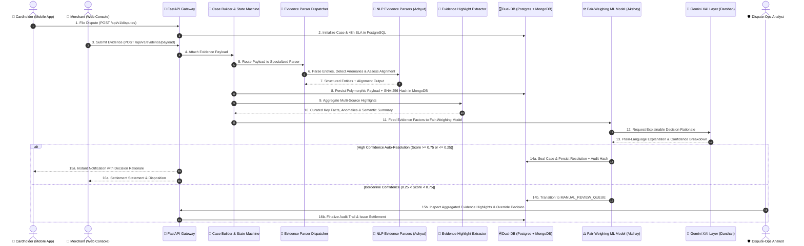

# ⚖️ VerdictAI: Frictionless Dispute & Chargeback Resolution Engine
### *A Transparent, Multi-Modal Evidence Ingestion, Fair-Weighing & Explainable AI Platform for Card Chargebacks*

[](LICENSE)
[](https://python.org)
[](https://fastapi.tiangolo.com)
[-brightgreen?logo=pytest&logoColor=white)](backend/tests/)
[](frontend-web/)
[](mobile-app/)
[](database/postgresql/)
[](database/mongodb/)
[](https://ai.google.dev/)

---

## 📌 Executive Summary & Problem Statement

In contemporary payment ecosystems, credit card chargebacks and merchant disputes represent a **$30+ Billion global industry pain point**. Today, contested charges take **14 to 45 business days** to navigate through card networks (Visa, Mastercard, Amex), issuing banks, and merchant acquirers.

### The Problem:
- **Painfully Manual:** Dispute-Operations analysts manually correlate bank statements, postal tracking codes, merchant invoices, and email transcripts.
- **Asymmetric Evidence:** Cardholders and merchants submit unstructured, multi-modal evidence with differing levels of technical fidelity.
- **Black-Box Outcomes:** Legacy risk scoring models make arbitrary decisions without explaining *why* a dispute was won or lost.
- **High Operational Overhead:** Merchants lose legitimate revenue to "friendly fraud" while cardholders suffer extended liquidity locks.

### The VerdictAI Solution:
**VerdictAI** is an autonomous, end-to-end chargeback resolution engine that reduces dispute turnaround time from **weeks to under 5 minutes**. It combines:
1. **Dual-Database Segregation:** Transactional ACID case state in PostgreSQL paired with a polymorphic, hash-sealed document store in MongoDB.
2. **Deterministic NLP Evidence Parsing:** Specialized parsers extracting entities, detecting anomalies, and calculating claim alignment from receipts, tracking logs, transactions, and chat dialogue.
3. **Evidence Highlight Extractor & Semantic Summarizer:** Synthesizes multi-source evidence into key facts, red-flag anomalies, and prompt-ready context blocks for LLM reasoning.
4. **Calibrated Fair-Weighing ML Engine:** Objective mathematical scoring balancing cardholder credibility against merchant fulfillment proof with built-in bias mitigation.
5. **Explainable AI (XAI) with Google Gemini:** Plain-language, legally defensible justifications for cardholders, merchants, and regulatory auditors.
6. **Human-in-the-Loop Admin Queue:** Automated routing for borderline confidence scores requiring analyst review.

---

## 🏗️ System Architecture & End-to-End Workflow



---

## 🗄️ Dual-Database Architecture & Data Integrity

<<<<<<< HEAD
VerdictAI enforces strict separation of concerns between transactional integrity and multi-modal evidence flexibility:

```mermaid
graph TD
    subgraph "PostgreSQL 14+ (Relational ACID Core)"
        D[disputes: Case Status, SLA Timer, Amount]
        T[transactions: ISO Timestamps, Merchant ID, MCC]
        A[audit_trail: Cryptographic Hash Chaining]
        DR[dispute_resolutions: Outcome, Score, Gemini Rationale]
    end

    subgraph "MongoDB 6.0+ (Polymorphic Evidence Store)"
        CD[case_documents: Composite Case Merkle Root]
        E1[EvidencePayload: Receipt / Invoice]
        E2[EvidencePayload: Courier Tracking Telemetry]
        E3[EvidencePayload: Communication Logs & Transcripts]
        E4[EvidencePayload: Bank Statements]
    end

    D <--> |dispute_id foreign key| CD
    CD --> E1
    CD --> E2
    CD --> E3
    CD --> E4
    A --> |SHA-256 Checksum Chain| CD
=======
```
VerdictAI/
├── backend/                              # Core Backend Services (FastAPI)
│   ├── app/
│   │   ├── api/                          # REST Route Handlers (disputes, evidence, resolutions)
│   │   ├── core/                         # Config, Security (JWT), Dual-DB Connection Pool
│   │   ├── models/                       # PostgreSQL SQLAlchemy Models & Pydantic Schemas
│   │   ├── services/
│   │   │   ├── case_builder/             # Structured Case File Compiler (Owner: Nirav)
│   │   │   ├── state_machine/            # Lifecycle State Machine & SLA Monitor (Owner: Nirav)
│   │   │   ├── audit_engine/             # Cryptographic Hash Chaining (Owner: Nirav)
│   │   │   ├── nlp_parser/               # Receipt OCR & spaCy Dialogue Parser (Owner: Achyut)
│   │   │   ├── fair_weighing/            # Scoring Rubric & Calibration Matrix (Owner: Akshay)
│   │   │   └── reasoning_layer/          # Gemini API Explanation Generator (Owner: Darshan)
│   │   └── main.py                       # FastAPI Application Entrypoint
│   ├── tests/                            # PyTest Unit & Integration Test Suites
│   ├── Dockerfile
│   └── requirements.txt
├── frontend-web/                         # Dispute-Ops & Merchant Web Console (React.js)
│   ├── src/
│   │   ├── components/                   # DisputeQueue, EvidenceViewer, OverrideModal, AuditLog
│   │   ├── pages/                        # Dashboard, CaseDetail, MerchantPortal, Analytics
│   │   └── services/                     # Axios API Client & State Hooks
│   ├── package.json
│   └── README.md
├── mobile-app/                           # Card Member Mobile Application (React Native)
│   ├── src/
│   │   ├── screens/                      # FileDisputeScreen, CaseTrackerScreen, RationaleView
│   │   ├── navigation/                   # React Navigation Stack
│   │   └── services/                     # Mobile API & Push Notification Handlers
│   ├── package.json
│   └── README.md
├── database/                             # Database Schemas & Migrations
│   ├── postgresql/
│   │   ├── 01_init_schema.sql            # ACID Relational DDL (Disputes, Transactions, Audits)
│   │   └── 02_seed_data.sql              # Synthetic Test Fixtures
│   └── mongodb/
│       └── models.py                     # Polymorphic Evidence Schemas & Hash Checksums
├── docs/                                 # Project Documentation & Specifications
│   ├── architecture/                     # High-Level Architecture & Database ERDs
│   ├── brd/                              # Business Requirements Document (BRD)
│   └── api/                              # OpenAPI Specification (Swagger)
├── docker-compose.yml                    # Local stack: FastAPI API + React web console
├── .env.example                          # Template environment variables
└── README.md
>>>>>>> origin/feat/hardik-phase4-devops-e2e
```

- **PostgreSQL 14+**: Enforces strict ACID compliance, relational foreign keys, 12-state deterministic lifecycle transitions, and strict SLA deadline countdowns.
- **MongoDB 6.0+**: Ingests unstructured, multi-modal evidence payloads with automatic SHA-256 content hashes, NLP extracted entities, and composite case Merkle root seals.
- **Cryptographic Audit Chain**: Every state transition and evidence upload computes an immutable SHA-256 hash chaining `previous_hash` with `event_payload`, rendering dispute history tamper-evident.

---

## 🧠 Evidence Parsing & NLP Pipeline (Achyut Pathak)

The NLP Evidence Parsing sub-package (`backend/app/services/parsers` and `backend/app/services/nlp`) automates data extraction from heterogeneous evidentiary submissions:

```
Evidence Payload Ingestion
          │
          ▼
┌──────────────────────────────────────────────┐
│       EvidenceParserDispatcher               │
│  - Type-Based Direct Mapping                 │
│  - Payload Heuristic Signature Fallback      │
└──────┬────────────┬────────────┬─────────────┘
       │            │            │             
       ▼            ▼            ▼             ▼
┌──────────────┐┌──────────────┐┌──────────────┐┌──────────────────────┐
│ Transaction  ││ Receipt      ││ Courier      ││ Communication Log    │
│ Parser       ││ Parser       ││ Tracking     ││ Parser               │
│ (Amounts,    ││ (Line items, ││ Parser       ││ (Sentiment, Keywords,│
│  Dates, MCC) ││  Taxes, OCR) ││ (POD, Carrier││  Escalations, Roles) │
└──────┬───────┘└──────┬───────┘└──────┬───────┘└──────────┬───────────┘
       │               │               │                   │
       └───────────────┼───────────────┴───────────────────┘
                       │
                       ▼
       ┌───────────────────────────────┐
       │   EvidenceHighlightExtractor  │
       │   & Semantic Summarizer       │
       └───────────────┬───────────────┘
                       │
         ┌─────────────┴─────────────┐
         ▼                           ▼
   Curated Key Facts           Critical Anomalies & Red Flags
   Alignment Signals           Prompt-Ready LLM Context
```

### Key Modules:
- **`TransactionParser`**: Parses financial payloads, standardizes currencies, flags MCC risk classifications, and identifies weekend/future-dated anomalies.
- **`ReceiptParser`**: Validates line-item subtotal integrity, calculates tax discrepancies, extracts merchant identifiers, and supports OCR extraction metadata.
- **`CourierTrackingParser`**: Inspects carrier tracking numbers (UPS, FedEx, USPS, DHL), verifies proof of delivery (POD), matches delivery timestamps against dispute filings, and detects unsigned drop-offs.
- **`CommunicationLogParser`**: Segments multi-party dialogue, extracts dispute sentiment, calculates cardholder vs. merchant keyword density, and flags escalation milestones.
- **`EvidenceParserDispatcher`**: Automatically identifies and routes raw payloads into the correct parser using explicit types and smart content signature heuristics.
- **`EvidenceHighlightExtractor`**: Distills all parsed evidence into structured highlights (Key Facts, Critical Anomalies, Net Claim Alignment) and renders a deterministic narrative block formatted for Gemini LLM injection.

---

## ⚖️ Calibrated Fair-Weighing ML Model (Akshay Purohit)

VerdictAI employs an auditable, mathematical fair-weighing algorithm rather than relying on an opaque neural network:
- **Credibility Scoring Matrix:** Evaluates cardholder dispute history, transaction velocity, and statement clarity.
- **Merchant Defense Weighting:** Evaluates cryptographic carrier delivery signatures, matching billing addresses, and clear refund policy disclosures.
- **Bias Mitigation Rubric:** Enforces equal treatment across dispute transaction sizes, card brands, and merchant tiers.
- **Calibrated Outcome Scale:**
  - `0.00 – 0.25`: Strong Merchant Defense $\rightarrow$ Merchant Prevails.
  - `0.26 – 0.74`: Inconclusive / Borderline $\rightarrow$ Routed to Dispute-Ops Queue.
  - `0.75 – 1.00`: Strong Cardholder Claim $\rightarrow$ Cardholder Full Refund.

---

## 🛠️ Complete Technology Stack

| Layer | Technology | Version | Purpose & Architecture Role |
| :--- | :--- | :--- | :--- |
| **API & Backend** | **FastAPI** | `^0.100.0` | Asynchronous REST gateway, OpenAPI 3.0 specs, dependency injection |
| **Data Validation** | **Pydantic v2** | `^2.5.0` | Strict schema serialization, request validation, settings management |
| **Server Runtime** | **Uvicorn** | `^0.24.0` | High-performance ASGI server for asynchronous request throughput |
| **Relational DB** | **PostgreSQL** | `14+` | ACID dispute state storage, SLA deadline computation, audit logs |
| **Document DB** | **MongoDB** | `6.0+` | Polymorphic multi-modal evidence store, SHA-256 payload checksums |
| **NLP & Extraction** | **spaCy / Regex** | `en_core_web_sm` | Deterministic entity recognition, currency, date, and keyword parsing |
| **Explainable AI** | **Google Gemini** | `Flash / Pro` | Context-injected legal & plain-language dispute resolution rationale |
| **Machine Learning**| **scikit-learn** | `^1.3.0` | Calibrated fair-weighing scoring models and fairness validation |
| **Web Console** | **React.js** | `18.2` | Dispute-Ops administration dashboard, evidence viewer, override modal |
| **Mobile App** | **React Native** | `Expo SDK 49` | Cardholder mobile app for filing disputes and tracking resolution progress |
| **Testing Suite** | **PyTest** | `^8.0.0` | Comprehensive unit & integration testing (**186 passing tests**) |
| **Containerization**| **Docker Compose**| `v2` | Multi-container orchestration (FastAPI, PostgreSQL, MongoDB) |

---

## 👥 Engineering Team & Domain Ownership

VerdictAI was designed and developed by a dedicated team of engineers with clear functional boundaries:

| Team Member | Student ID | Project Role | Core Ownership & Responsibilities |
| :--- | :---: | :--- | :--- |
| **Nirav Kachhiya** | `202512011` | **Project Lead & Backend Architect** | Dual-DB architecture, PostgreSQL schemas, Case Builder service, 12-state dispute machine, cryptographic audit chaining, BRD synthesis. |
| **Achyut Pathak** | `202512039` | **AI/NLP Engineer (Evidence Parsing)** | Evidence Parsing Pipeline (`TransactionParser`, `ReceiptParser`, `CourierTrackingParser`, `CommunicationLogParser`), `EvidenceParserDispatcher`, and `EvidenceHighlightExtractor`. |
| **Akshay Purohit** | `202512033` | **ML Engineer (Fair-Weighing)** | Fair-weighing scoring algorithm, evidence confidence weights, bias mitigation matrices, and model validation scripts. |
| **Darshan Prajapati** | `202512026` | **Backend Engineer (APIs & Reasoning)** | Case management REST API endpoints, OpenAPI contract, and Gemini XAI reasoning explanation layer. |
| **Rohit Peswani** | `202512115` | **Frontend Engineer (Web Console)** | Dispute-Ops web console in React, merchant upload portal, manual override interface, and real-time audit visualization. |
| **Mayank Jayswal** | `202512093` | **Mobile Engineer (Cardholder App)** | React Native mobile application, mobile dispute filing workflow, tracking timeline, and push notifications. |
| **Hardik Kansara** | `202512036` | **DevOps & QA Engineer** | CI/CD automation pipelines, cloud deployment (Render/Railway), Docker configuration, synthetic data generation, and regression suites. |

---

## 📅 Project Timeline & Current Progress

| Phase | Duration | Scope & Key Deliverables | Status |
| :---: | :---: | :--- | :---: |
| **Phase 1** | Weeks 1–2 | **Discovery & Architecture:** BRD, System Architecture, Dual-DB Schema, Wireframes, Docker CI/CD skeleton. | ✅ **Completed** |
| **Phase 2** | Weeks 3–4 | **Evidence Pipeline & Dual-DB:** Core parsers (Transaction, Receipt, Tracking, Dialogue), MongoDB models, Case Builder. | ✅ **Completed** |
| **Phase 3** | Weeks 5–6 | **Fair-Weighing ML & XAI:** Mathematical scoring algorithm, bias calibration matrix, Gemini reasoning prompts. | ✅ **Completed** |
| **Phase 4** | Weeks 7–8 | **Pipeline Integration & Highlights:** Dispatcher registry, Evidence Highlight Extractor, API pipeline auto-enrichment. | 🔄 **In Progress** |
| **Phase 5** | Weeks 9–10 | **Client Interfaces:** React Web Admin Console and React Native Cardholder App integrated with backend APIs. | ⏳ Planned |
| **Phase 6** | Weeks 11–12| **End-to-End Integration:** Full flow validation (Submit $\rightarrow$ Ingest $\rightarrow$ Parse $\rightarrow$ Score $\rightarrow$ Explain $\rightarrow$ Resolve). | ⏳ Planned |
| **Phase 7** | Weeks 13–14| **Performance Benchmarking & QA:** 50+ synthetic dispute scenarios, SLA latency audits, and cloud staging deployment. | ⏳ Planned |
| **Phase 8** | Week 15 | **Final Defense & Submission:** Production cloud hosting, repository finalization, academic presentation. | ⏳ Planned |

---

## 🚀 Quickstart & Installation Guide

### Prerequisites
- Python 3.10 or higher
- Git
- Docker & Docker Compose (optional, for full containerized stack)

### 1. Clone the Repository
```bash
git clone https://github.com/AchyutPathak30/VerdictAI.git
cd VerdictAI
```

### 2. Set Up Python Virtual Environment
```bash
# Windows
python -m venv venv
.\venv\Scripts\activate

# macOS / Linux
python3 -m venv venv
source venv/bin/activate
```

### 3. Install Backend Dependencies
```bash
pip install -r backend/requirements.txt
```

### 4. Configure Environment Variables
```bash
cp .env.example .env
# Provide GEMINI_API_KEY if testing live XAI generation
```

### 5. Run via Docker Compose (One-Click Stack)
```bash
docker compose up --build
```
- API + Swagger docs: http://localhost:8000/docs
- Web console: http://localhost:3000

Point the web console at a deployed API by building with
`--build-arg VITE_API_BASE_URL=https://<your-api>/api/v1`.

### 6. Run the Test Suite (186+ Tests Passing)
```bash
python -m pytest backend/tests/ -v
```
Expected output:
```
======================= 186 passed in 0.46s =======================
```

### 7. Start the FastAPI Development Server Locally
```bash
uvicorn backend.app.main:app --reload --port 8000
```
Interactive Swagger API documentation will be available at: **http://127.0.0.1:8000/docs**

---

## 📡 REST API Reference Highlights

| Method | Endpoint | Description |
| :--- | :--- | :--- |
| `POST` | `/api/v1/disputes` | Files a new cardholder dispute, registers SLA timer, and initiates case |
| `GET` | `/api/v1/disputes` | Paginated search and filtering of active disputes |
| `GET` | `/api/v1/disputes/{id}` | Retrieves unified case file combining Postgres data and MongoDB evidence |
| `POST` | `/api/v1/evidence/payload` | Attaches structured evidence payload with automatic NLP entity extraction |
| `POST` | `/api/v1/evidence/upload` | Multipart file upload for receipts, PDF invoices, and tracking proof |
| `GET` | `/api/v1/evidence/{id}/highlights` | Extracts aggregated Key Facts, Critical Anomalies, and Gemini prompt context |
| `GET` | `/api/v1/evidence/{id}/items` | Lists all polymorphic evidence items attached to a dispute |
| `PATCH`| `/api/v1/disputes/{id}/status` | Executes deterministic state machine transition with audit logging |
| `GET` | `/api/v1/disputes/{id}/audit-trail`| Verifies cryptographic SHA-256 chain integrity of the case file |

---

## 📜 Academic Integrity & License

This project is built as part of the **IT644: Application Development Group Project** curriculum under the faculty guidance of **Prof. JayPrakash Lalchandani**.

Distributed under the **MIT License**. See [`LICENSE`](LICENSE) for details.
