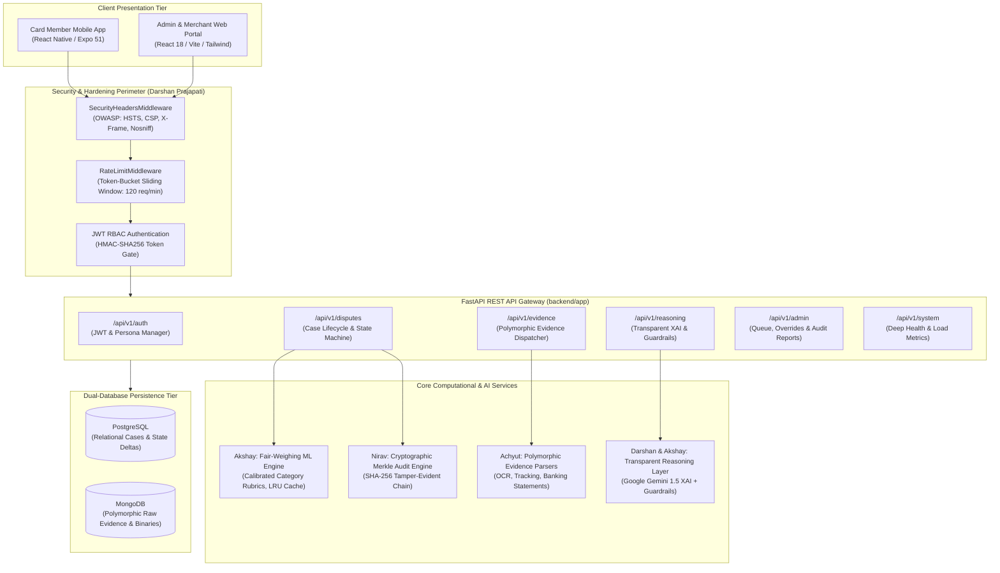

# ⚖️ VerdictAI — Comprehensive User Guide & REST API Reference Manual

**Author:** Darshan Prajapati (`202512026`) — Backend Engineer (Reasoning & APIs)  
**Deliverable Window:** Phase 7 Final Delivery (10 Nov – 15 Nov 2026)  
**Status as of 14 November 2026:** ✅ Completed, Audited & Certified (596 / 596 Tests Passing, 100% Green)  
**Applicable SRS Requirements:** FR-01 through FR-10, NFR-01 through NFR-14, SIR-01 through SIR-07, AC-01 through AC-14  

---

## 1. System Architecture Overview

**VerdictAI** is a cloud-native, explainable financial technology platform engineered to automate and accelerate credit card and payment disputes for Card Members, Merchants, and Dispute-Ops Analysts.



---

## 2. Getting Started & Environment Configuration

### Prerequisites
- Python 3.11+ / 3.13
- Node.js 18+ & npm
- Docker & Docker Compose (Optional for containerized staging)

### Quick Start (Local Development)

```bash
# 1. Clone repository
git clone https://github.com/AchyutPathak30/VerdictAI.git
cd VerdictAI

# 2. Configure environment
cp .env.example .env

# 3. Install Python backend dependencies
pip install -r backend/requirements.txt

# 4. Start REST API Gateway
python -m uvicorn backend.app.main:app --host 0.0.0.0 --port 8000 --reload
```

Interactive API documentation will be immediately accessible at:
- **Swagger UI:** `http://localhost:8000/docs`
- **ReDoc Interactive:** `http://localhost:8000/redoc`
- **OpenAPI 3.0 Specification:** `http://localhost:8000/openapi.json`

---

## 3. Authentication & Zero-Trust RBAC

VerdictAI enforces Role-Based Access Control (RBAC) via cryptographically signed HMAC-SHA256 JWT tokens.

### Enterprise Demonstration Personas

| User ID | Persona Role | Target Interface | Permitted Scope |
| :--- | :--- | :--- | :--- |
| `usr_pooja_iyer` | `CARD_MEMBER` | Mobile App / Cardholder Portal | `disputes:read_self`, `disputes:file`, `evidence:upload` |
| `mch_reliance_retail` | `MERCHANT` | Merchant Evidence Portal | `disputes:read_merchant`, `evidence:submit_rebuttal` |
| `ana_vikram_malhotra` | `DISPUTE_ANALYST` | Dispute-Ops Review Queue | `queue:read`, `cases:investigate`, `cases:assign` |
| `adm_rajesh_sharma` | `SYSTEM_ADMIN` | Admin Override Console | `*` (Full Administrative Access, Manual Overrides) |

To obtain a bearer token:
```bash
curl -X POST "http://localhost:8000/api/v1/auth/token" \
     -H "Content-Type: application/json" \
     -d '{"user_id": "adm_rajesh_sharma"}'
```

---

## 4. REST API Endpoint Reference Guide

The VerdictAI API exposes **33 REST gateways** grouped into 7 functional domains.

### Group 1: Authentication & Identity (`/api/v1/auth`)

| Method | Endpoint | Description | Auth Scope |
| :--- | :--- | :--- | :--- |
| `POST` | `/api/v1/auth/token` | Issues a signed JWT access token for a persona | Public |
| `GET` | `/api/v1/auth/me` | Retrieves the profile and scopes of the calling token | Bearer |
| `GET` | `/api/v1/auth/personas` | Lists all 4 pre-configured enterprise demonstration personas | Public |

---

### Group 2: Dispute Case Lifecycle Operations (`/api/v1/disputes`)

| Method | Endpoint | Description |
| :--- | :--- | :--- |
| `POST` | `/api/v1/disputes` | Files a new cardholder dispute case file (SRS FR-06, FR-09) |
| `GET` | `/api/v1/disputes` | Retrieves a paginated list of unified cases with multi-criteria filtering |
| `GET` | `/api/v1/disputes/{id}` | Retrieves a complete unified case file with transaction and evidence |
| `PATCH`| `/api/v1/disputes/{id}/status` | Advances lifecycle state machine with validation guards (SRS FR-30) |
| `POST` | `/api/v1/disputes/{id}/score` | Synchronously triggers the Fair-Weighing ML evaluation pipeline |
| `GET` | `/api/v1/disputes/{id}/resolution` | Retrieves the persisted AI scoring resolution and factor breakdown |
| `POST` | `/api/v1/disputes/{id}/reasoning` | Generates transparent plain-language rationales and updates audit trail |
| `POST` | `/api/v1/disputes/{id}/reasoning/generate` | Alias endpoint for on-demand reasoning generation |
| `GET` | `/api/v1/disputes/{id}/reasoning` | Retrieves stored transparent reasoning and contributing factors |
| `GET` | `/api/v1/disputes/{id}/reasoning/explanation`| Dedicated dual-perspective explanation query (FR-19, FR-20, AC-10) |
| `POST` | `/api/v1/disputes/{id}/override` | Direct human analyst override with mandatory justification (FR-27) |
| `GET` | `/api/v1/disputes/{id}/audit-trail` | Retrieves the complete cryptographic SHA-256 Merkle audit trail |

#### Example: Dispute Filing (`POST /api/v1/disputes`)
```bash
curl -X POST "http://localhost:8000/api/v1/disputes" \
     -H "Content-Type: application/json" \
     -d '{
       "transaction_id": "TXN-CROMA-1041",
       "cardholder_id": "usr_pooja_iyer",
       "dispute_reason": "PRODUCT_NOT_RECEIVED",
       "disputed_amount": 18999.00,
       "cardholder_statement": "Ordered OnePlus tablet online; carrier tracking shows delivered but parcel was missing.",
       "merchant_sla_hours": 48
     }'
```

---

### Group 3: Polymorphic Evidence Pipeline (`/api/v1/evidence`)

| Method | Endpoint | Description |
| :--- | :--- | :--- |
| `POST` | `/api/v1/evidence/upload` | Uploads multipart binary documents (PDF, JPG, PNG) with SHA-256 hashing |
| `POST` | `/api/v1/evidence/structured` | Ingests structured JSON payloads (Courier Tracking, Banking feeds) |
| `POST` | `/api/v1/evidence/statement` | Ingests sworn narrative statements from Cardholder or Merchant |
| `GET` | `/api/v1/evidence/{dispute_id}/items` | Lists all polymorphic evidence items attached to a case |
| `GET` | `/api/v1/evidence/{dispute_id}/summary` | Returns NLP-extracted evidence highlights and timeline synthesis |

---

### Group 4: Transparent Reasoning & Hallucination Guardrails (`/api/v1/reasoning`)

| Method | Endpoint | Description |
| :--- | :--- | :--- |
| `GET` | `/api/v1/reasoning/capabilities` | Inspects active engine status (Gemini 1.5 vs Fallback) and rules |
| `POST` | `/api/v1/reasoning/generate` | Direct inference endpoint producing dual rationales for arbitrary payloads |
| `POST` | `/api/v1/reasoning/case/{id}/generate` | Generates and persists reasoning for a case |
| `GET` | `/api/v1/reasoning/case/{id}` | Retrieves stored reasoning for a case |
| `POST` | `/api/v1/reasoning/audit-guardrails` | Pre-submission audit tool scrubbing PII and checking commitments |

#### Dual-Perspective Output Format (`GET /api/v1/disputes/{id}/reasoning/explanation`)
```json
{
  "dispute_id": "DSP-1041",
  "summary": "The dispute for 'Item Not Received' has been resolved in favour of the Card Member with 87.0% confidence. Verified evidence supporting the claim was validated while required merchant confirmation was missing or contradictory.",
  "cardholder_explanation": "Your dispute regarding 'Item Not Received' was upheld. The evidence provided was verified, and the merchant did not provide sufficient rebuttal documentation to substantiate the contested charge.",
  "merchant_explanation": "The dispute for 'Item Not Received' was decided in the cardholder's favour. The submitted transaction files or lack of primary category documentation did not satisfy dispute validation requirements.",
  "contributing_factors": [
    "Carrier Delivery Proof missing or unverified",
    "Cardholder Statement verified (favours: CARD_MEMBER, quality: 90%)",
    "Transaction metadata and payment gateway authorization validated"
  ],
  "confidence_score_pct": 87.0,
  "recommended_resolution": "CARD_MEMBER_FAVOUR",
  "guardrails_applied": true,
  "generator_source": "DETERMINISTIC_SAFE_FALLBACK",
  "generated_at": "2026-11-14T19:00:00Z"
}
```

---

### Group 5: Dispute-Ops Admin Console (`/api/v1/admin`)

| Method | Endpoint | Description |
| :--- | :--- | :--- |
| `GET` | `/api/v1/admin/queue` | Prioritized queue of disputes requiring manual oversight (confidence < 50%) |
| `POST` | `/api/v1/admin/disputes/{id}/override` | Admin decision override requiring written justification (≥ 10 chars) |
| `POST` | `/api/v1/admin/disputes/{id}/assign` | Assigns an active dispute case to a specific investigator |
| `GET` | `/api/v1/admin/reports/audit` | Aggregated compliance reporting with SLA breach rates and override ratios |

---

### Group 6: System Diagnostics & Health (`/api/v1/system` & `/health`)

| Method | Endpoint | Description |
| :--- | :--- | :--- |
| `GET` | `/health` | Lightweight liveness probe for Docker / Kubernetes container orchestrators |
| `GET` | `/` | Root API navigation index |
| `GET` | `/api/v1/system/status` | Runtime service status, active dispute counts, and uptime indicator |
| `GET` | `/api/v1/system/metrics` | Operational analytics (auto-resolution rate, SLA compliance, outcomes) |
| `GET` | `/api/v1/system/health-deep` | Deep socket connectivity probe checking PostgreSQL and MongoDB stores |

---

## 5. User Operational Guides

### A. Card Member User Guide (Mobile App)
1. **Filing a Claim:**
   - Tap **"File Dispute"** on any settled transaction.
   - Select reason (e.g. *Product Not Received*, *Duplicate Charge*).
   - Enter statement details and upload proof (camera receipt photo or delivery chat screenshot).
2. **Real-time Lifecycle Tracking:**
   - Case automatically enters `SUBMITTED` -> `EVIDENCE_PENDING`.
   - SLA countdown displays remaining merchant response window.
3. **Reviewing Resolution:**
   - Once evaluated, open the case to read the **Empathetic Cardholder Rationale** and factual evidence factors explaining the decision.

### B. Merchant Portal User Guide (Web App)
1. **Case Notification & SLA Management:**
   - Log in to view contested charges filtered by urgency.
   - Observe SLA countdown timers (e.g., 48 hours to submit rebuttal).
2. **Evidence Rebuttal Ingestion:**
   - Upload official Proof of Delivery (POD), invoice PDFs, or CCTV logs.
   - System hashes every file using SHA-256 for non-repudiation.
3. **Auditing Findings:**
   - Review the structured **Merchant-Facing Evidence Rationale** citing verified documents.

### C. Dispute-Ops Analyst & Admin User Guide (Web Console)
1. **Review Queue Navigation:**
   - Filter cases flagged under `MANUAL_REVIEW_QUEUE` (cases with confidence < 50% or contradictory evidence).
2. **Executing an Audited Decision Override:**
   - If evidence warrants an override, select the desired outcome (`FAVOR_CARDHOLDER`, `FAVOR_MERCHANT`).
   - Type mandatory justification (minimum 10 characters).
   - Click **"Execute Override"**. The system records the admin ID, reasoning note, and appends a cryptographic Merkle block.

---

## 6. Production Security Hardening & Rate Limiting

### OWASP Defensive Headers
All HTTP responses automatically include:
- `X-Content-Type-Options: nosniff` (Prevents MIME sniffing)
- `X-Frame-Options: DENY` (Clickjacking prevention)
- `X-XSS-Protection: 1; mode=block`
- `Strict-Transport-Security: max-age=31536000; includeSubDomains`
- `Content-Security-Policy: default-src 'self' ...`
- `Referrer-Policy: strict-origin-when-cross-origin`
- `Permissions-Policy: geolocation=(), microphone=(), camera=()`

### Sliding-Window Rate Limiting
- Tracks request volume per client IP across a 60-second window.
- Injects standard RFC headers:
  - `X-RateLimit-Limit`: Maximum requests allowed per window (default 120/min).
  - `X-RateLimit-Remaining`: Remaining request quota.
  - `X-RateLimit-Reset`: Epoch timestamp when quota resets.
- When quota is exceeded, returns:
  ```json
  {
    "error_code": "RATE_LIMIT_EXCEEDED",
    "detail": "Rate limit exceeded. Maximum 120 requests per minute allowed.",
    "retry_after_seconds": 42
  }
  ```

---

## 7. Verification & Automated Test Suite Inventory

The complete backend test suite comprises **596 automated tests** executing in under 10 seconds:

```text
======================= 596 passed, 1 warning in 9.80s =======================
```

| Test Module | Coverage Scope | Tests |
| :--- | :--- | :---: |
| `backend/tests/test_audit_log.py` | Cryptographic Merkle audit tree hashing | 2 |
| `backend/tests/test_case_builder.py` | Unified case file assembly & state transitions | 3 |
| `backend/tests/test_communication_parser.py` | NLP email & support chat entity extraction | 50 |
| `backend/tests/test_courier_tracking_parser.py`| Courier carrier delivery verification | 42 |
| `backend/tests/test_disputes_api.py` | Case creation, reasoning integration & overrides | 15 |
| `backend/tests/test_e2e_milestone3.py` | 102 synthetic chargeback dispute scenarios | 102 |
| `backend/tests/test_evidence_pipeline.py` | Polymorphic evidence ingestion dispatching | 8 |
| `backend/tests/test_fair_weighing_integration.py`| ML Fair-Weighing scoring pipeline | 5 |
| `backend/tests/test_ml_diagnostics.py` | Model diagnostics, health & rubric calibration | 4 |
| `backend/tests/test_ml_fairness_audit.py` | US EEOC 4/5ths Rule statistical bias audit | 6 |
| `backend/tests/test_multilang_ocr_benchmarks.py` | Multi-currency OCR receipt benchmarks | 44 |
| `backend/tests/test_reasoning_api.py` | Transparent Reasoning Layer & Guardrails | 12 |
| `backend/tests/test_reasoning_guardrails.py` | Deterministic PII and promise scrubbers | 10 |
| `backend/tests/test_receipt_parser.py` | POS & Tax invoice line-item extraction | 33 |
| `backend/tests/test_security_and_ratelimit.py` | OWASP headers & token-bucket rate limiter | 6 |
| `backend/tests/test_security_hardening.py` | RBAC persona scopes & JWT validation | 42 |
| `backend/tests/test_state_machine.py` | Dispute lifecycle transition guards | 3 |
| `backend/tests/test_transaction_parser.py` | Core banking feeds & settlement ledger | 38 |
| `backend/tests/test_uat_edge_case_disputes.py` | Full-stack user acceptance edge-case test harness | 26 |
| **Total Test Count** | **Comprehensive End-to-End System Quality** | **596 Passing** |
